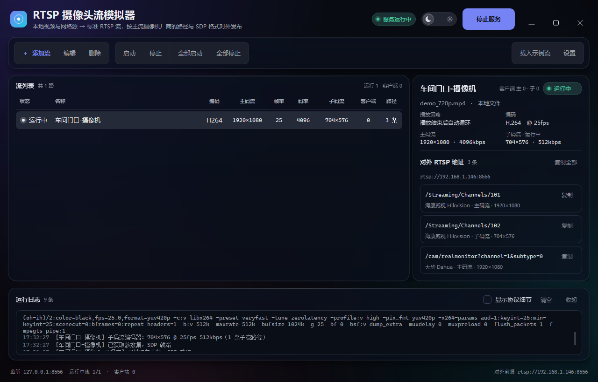
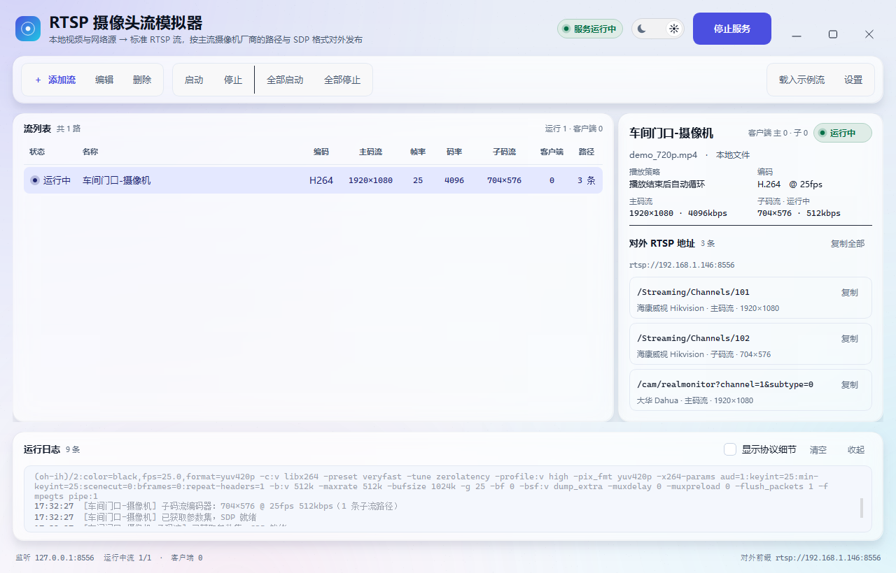

# RTSP 摄像头流模拟器

把本地视频文件变成一台「虚拟摄像机」：按主流监控厂商的 **RTSP 路径** 和 **SDP 格式** 对外发布，
给需要 RTSP 流的平台、客户端、SDK 做接入测试。

- 平台：Windows 10/11
- 运行时：Python 3.10+、ffmpeg（用于把任意格式转成 H.264/H.265）
- 界面：PySide6
- 协议栈：自研 RTSP 服务端（不依赖第三方流媒体服务器，路径与 SDP 可完全按厂商定制）

<p align="center">
  
  
</p>

---

## 一、功能

| 能力 | 说明 |
| --- | --- |
| 本地视频源 | mp4 / mkv / avi / mov / flv / wmv / ts / webm / m4v / 裸流 h264、h265（ffmpeg 能解的都能用） |
| 网络视频源 | 直接把 URL 当视频源：HTTP/HTTPS 点播文件、HLS(m3u8)、RTSP/RTSPS、RTMP/RTMPS、UDP 组播、SRT。断线自动重连（3s 起、最长 30s 退避） |
| 哔哩哔哩视频页 | 直接粘 `https://www.bilibili.com/video/BVxxx`（或 b23.tv 短链），启动时自动解析成 1080P 直链；默认要求 1080P，拿不到就报错。可选填 SESSDATA 提升到需要登录的清晰度 |
| 主码流 + 子码流 | 同一路视频按摄像机习惯分两档：主码流（101 / subtype=0 / video1）按一套参数编码，子码流（102 / subtype=1 / video2）单独再起一个轻量编码器，分辨率/帧率/码率各自可配 |
| 循环策略 | 每路流单独开关：**播完自动循环**（等价于永不结束的摄像机）或 **播完即停**（文件放到尾就结束，状态变「已停止」）。本地源与网络源都适用 |
| 编码 | H.264（推荐）/ H.265，分辨率、帧率、码率可调，默认可模拟主码流 1080P@4096kbps、子码流 D1@512kbps 这类摄像机出厂档位 |
| 厂商模拟 | 同一路视频可同时挂 **多条** 厂商路径：一次同时扮演海康 + 大华，任意客户端按对应厂商 URL 接入 |
| 传输 | RTP over **UDP** 与 RTP over **TCP（interleaved 交织）** 均支持，多客户端并发（共享同一份编码码流） |
| 协议 | OPTIONS / DESCRIBE / SETUP / PLAY / PAUSE / TEARDOWN / GET_PARAMETER / SET_PARAMETER，附带 RTCP SR |
| 运维 | 地址一键复制、运行日志、流级启停、状态与客户端数实时显示、配置持久化到 `config.json` |

---

## 界面与视觉规范（Aurora Glass 现代毛玻璃）

程序内置 **深色 Obsidian / 浅色 Frost** 两套主题，共用同一套设计尺寸 token，只换色值与玻璃参数。
视觉层分三块：自绘背景画布（`glass.py`）、玻璃卡片与命令分组（`glass.py` / `widgets.py`）、
全局 QSS 与色板（`theme.py`）。

**切换方式**

- 主窗口顶栏右侧的**太阳 / 月亮图标开关**（滑块滑动切换，点整块都算），或「设置 → 界面」下拉框，两处状态互相同步；
- 切换**实时生效**（只重绘样式，不重启编码器、不断开 RTSP 客户端、不清空日志）；
- 主题选择写入 `config.json` 的 `theme` 字段（`dark` / `light`）；旧配置缺该字段时默认深色，非法值回退深色。

**布局（信息架构）**

| 区域 | 内容 |
| --- | --- |
| 顶部标题栏 | 品牌标记 + 应用名 / 副标题 · 服务状态胶囊 · 主题图标开关 · 主按钮（启动/停止服务） · 窗口按钮 |
| 命令栏 | 三个下沉分组：「＋ 添加流 / 编辑 / 删除」「启动 / 停止 ｜ 全部启动 / 全部停止」「载入示例流 / 设置」 |
| 流列表 | 表格只放状态与规格概览（状态点 + 名称 + 编码 + 主/子码流 + 帧率码率 + 客户端 + 路径条数） |
| 详情栏 | 选中流的播放策略 / 编码 / 主码流 / 子码流 + 对外地址逐条卡片（地址前缀单独标一次，行内只列路径，逐条可复制） |
| 运行日志 | 底部可折叠窄条（标题行常驻，正文可收起），等宽字体按级别着色 |
| 页脚 | 监听地址 · 运行中流 / 客户端数 · 对外地址前缀 |

**尺寸 token（两套主题一致）**

| 类别 | 取值 |
| --- | --- |
| 间距栅格 | 8 / 12 / 16 / 24 / 32 px（卡片间距 14，卡片内边距 16，命令分组内 2~4 / 组间 12） |
| 圆角 | 卡片 16、控件/输入 10、小控件 8、胶囊 999 |
| 字阶 | 标题 22px/700、区块标题 13px/600、正文 13px/400、次要 12px、说明 11px；数字与地址用等宽字体 |
| 控件高度 | 主/次按钮 34px、分组内幽灵按钮 28px、输入框/下拉/数字框 34px、表格行高 44px、表头 38px |

**玻璃质感实现（窗口内部自绘，不使用整窗透明）**

- `AuroraCanvas` 是窗口最底层自绘背景：竖向渐变 + **三团**径向彩色光晕（左上紫罗兰、右下青绿、左下玫红）
  + 暗角 + ≤3% 噪点，全部缓存到一张 QPixmap，仅在 resize / 换主题时重算。
  光晕是玻璃「透光」的唯一色彩来源——没有它，半透明玻璃叠在灰黑底上只会得到一块脏灰色板子，
  这是旧版界面发闷的根因。
- `GlassCard` 从画布缓存中截取自身几何对应的背景切片，做离屏高斯模糊（半径 22px）并缓存，
  再叠**带色调的玻璃霜面**（深色主题用墨蓝 `#0C1220`@62%，浅色用白@70%，不是白 alpha 提亮）、
  1px 玻璃边、顶部中间最亮的弧光；柔和投影由 `QGraphicsDropShadowEffect`（模糊 30、偏移 0/+8）提供。
- 模糊切片只在尺寸变化或换主题时重算，`paintEvent` 不做实时模糊；全程在窗口内部绘制，
  `widget.grab()` 截出来的图就是真实观感（不使用 `WA_TranslucentBackground` 接桌面，避免截图拍成黑底）。

**深色 Obsidian**

| 角色 | 色值 |
| --- | --- |
| 画布渐变 | `#080B12` → `#04060A`；光晕 紫罗兰 `#6B4DFF`@26%、青绿 `#1FC8E3`@17%、玫红 `#E85D9B`@11%；暗角 @60% |
| 玻璃霜面 / 强玻璃 | 墨蓝 `#0C1220` @70% / @80%；玻璃边 白 @13% / 强边 @22% |
| 合成 surface / elevated / input | `#151A26` / `#202838` / `#0F1420` |
| 边框 border / border_strong | `#232B3B` / `#33405A` |
| 正文 text / 次要 secondary / 说明 muted / 标题 title | `#DCDFE6` / `#A3A8B3` / `#868B97` / `#EDEFF4` |
| 强调 accent / hover / on_accent | `#7583F5` / `#8E9BFF` / `#070A14` |
| 成功 / 警告 / 危险 / 待机 | `#41C99B` / `#E2AE55` / `#F27A85` / `#868B97` |
| 选中底 / 选中文字 / hover 底 | `#252A38` / `#EDEFF4` / `#1C2028`；投影 黑 @42% |

深色主题的正文色刻意压到 11~14:1 这一档（不用接近纯白），并取中性偏暖而非冷蓝：
底色是冷紫，文字再带蓝就会互相串色、像蒙了一层灰紫膜；接近纯白的大字号在深底上会
产生光晕（halation），长时间看容易累。状态色同样降了一档饱和度，避免绿/红压在紫玻璃上「跳」出来。

**浅色 Frost**

| 角色 | 色值 |
| --- | --- |
| 画布渐变 | `#E8EDF7` → `#F7F9FD`；光晕 紫罗兰 `#6B4DFF`@16%、青绿 `#1FC8E3`@13%、玫红 `#F078AD`@10% |
| 玻璃霜面 / 强玻璃 | 白 @70% / @86%；玻璃边 `#0B1220` @5.5% / 强边 @11% |
| 合成 surface / elevated / input | `#FFFFFF` / `#FFFFFF` / `#FFFFFF` |
| 边框 border / border_strong | `#E3E9F3` / `#C9D4E5` |
| 正文 text / 次要 secondary / 说明 muted / 标题 title | `#111A2B` / `#48586F` / `#5F6E82` / `#0A1220` |
| 强调 accent / hover / on_accent | `#4B4FE0` / `#6366F1` / `#FFFFFF` |
| 成功 / 警告 / 危险 / 待机 | `#067048` / `#B45309` / `#D22B4B` / `#5F6E82` |
| 选中底 / 选中文字 / hover 底 | `#E4E8FF` / `#1E2470` / `#F2F5FD`；投影 `#1B2A4A`@13% |

**按钮与控件体系**

- **主按钮（唯一最重要动作，如启动服务）**：实心强调色 `#7B8CFF` / `#4B4FE0`，文字取深墨 / 白；
  高 34、圆角 10。
- **命令分组（`QFrame#ToolGroup`）**：一组动作用下沉胶囊圈起来，组内按钮为无边框「幽灵」按钮，
  hover 才显淡底；「＋ 添加流」用强调色文字区分主次，「删除」hover 才转红。
- **次按钮**：玻璃底 + 1px 玻璃边 + 正文色，hover 提亮一档。
- **危险按钮**：透明底 + danger 细边 + danger 文字，hover 填充 danger@12%，不用粉色块。
- **表格**：去网格线、去斑马纹；选中行是一条连续圆角高亮带（只在首列/末列做圆角）+ 第一列
  状态圆点（颜色随状态），数值列用等宽字体对齐。
- **状态胶囊（自绘 `StatusPill`）**：状态色 13% 淡底 + 32% 细边 + 左侧圆点与光晕，600 字重 12px。
- **主题开关（自绘 `ThemeSwitch`）**：76×30 胶囊轨道 + 24px 实体圆钮，左月亮（深色）/ 右太阳（浅色），
  点击后滑块 150ms 缓动滑过，图标纯 `QPainter` 绘制；支持 Tab 聚焦 + 空格切换，键盘聚焦时才画焦点环。
- **地址卡（`UrlRow`）**：等宽路径 + 厂商/码流说明 + 行内「复制」；地址前缀在区块里单独标一次。

正文 / 次要 / 说明对各自底色对比度均 ≥ 4.5:1；状态胶囊 600 字重 ≥ 4:1（深色全部 ≥4.6:1），
按 WCAG 相对亮度公式核算，明细见 `docs/设计说明.md` §8。

---

## 二、快速开始

```bat
:: 0) 克隆（也可以直接下载 ZIP 解压）
git clone https://github.com/lp2924/rtsp-cam-sim.git
cd rtsp-cam-sim

:: 1) 首次运行：双击 启动.bat，会自动创建 .venv 并安装 PySide6
启动.bat
```

> 还需要系统里能调用的 **ffmpeg**（`ffmpeg -version` 有输出即可）。装好但不在 PATH 里，
> 到「设置」里手动指定 `ffmpeg.exe` 路径。

界面操作顺序：

1. 右上角 **启动服务**（默认监听 `0.0.0.0:8554`，对外地址取本机网卡 IP）
2. **添加流** → 视频源填本地文件路径、网络地址（`http://`、`https://`、`rtsp://`、`rtmp://`、`udp://`、`srt://`）或 **哔哩哔哩视频页链接** → 决定「循环」开关（默认勾选＝播完自动重播，取消勾选＝播完即停）→ 需要主/辅两档画质时勾上 **子码流** 并设好参数（见第六节）→ 勾选要模拟的厂商路径（可多选）→ 保存
3. 选中该流点 **启动**（启动服务后添加的流会自动启动）
4. 右侧面板出现形如 `rtsp://192.168.1.146:8554/Streaming/Channels/101` 的地址，点 **复制全部地址**

### 用客户端验证

```bat
:: 探测流信息
ffprobe -rtsp_transport tcp rtsp://192.168.1.146:8554/Streaming/Channels/101

:: 直接播放
ffplay -rtsp_transport tcp rtsp://192.168.1.146:8554/Streaming/Channels/101

:: 用 UDP 传输
ffplay rtsp://192.168.1.146:8554/Streaming/Channels/101
```

VLC：`媒体 → 打开网络串流`，粘贴地址即可。若网络有丢包或客户端只支持 TCP，在 VLC 里选「更多选项 → 显示更多选项 → 访问模块 : live555 → RTP over RTSP (TCP)。

### 跑一遍自动化自检

```bat
.venv\Scripts\python.exe tools\selftest.py
```

自检会用真实 ffprobe / ffmpeg 以客户端身份连上来，覆盖 26 项：
服务启动、编码出帧、TCP/UDP 探测、带查询串的大华路径、连续解码无告警、
双客户端并发、H.265 编码/探测/解码、**HTTP 源拉流转出**、**HLS 源拉流转出**、
**循环关闭时播完即停**、**播完停止后客户端被明确拒绝(503)**、
**循环开启时播完继续出流**、**循环接缝处解码无告警**、
**主/子码流双编码器就绪**、**101 量到 1920×1080、102 量到 704×576**、**两路各解码 3 秒无告警**、
停止后路由摘除、服务关闭。网络源部分会在本机 8099 端口临时起一个 HTTP 服务喂流，用完即关；
循环策略用一段 2 秒短片段验证（`samples/short_2s.mp4`，首次自检时自动生成）。

哔哩哔哩解析依赖联网，所以不进离线自检，单独给了工具：

```bat
:: 解析 + 用 ffprobe 验证直链（默认要求 1080P）
.venv\Scripts\python.exe tools\bili_check.py https://www.bilibili.com/video/BV1hh4y1N7k2/
```

---

## 三、网络视频源（不止本地文件）

「添加流」的视频源输入框接受任何 ffmpeg 能打开的 URL，输入时会实时提示「识别为网络流」。

| 协议 | 典型地址 | 说明 |
| --- | --- | --- |
| HTTP/HTTPS 文件 | `http://host/a.mp4` | 服务器需支持 Range 请求，或文件是 `+faststart`（moov 在头部） |
| HLS | `https://host/live/index.m3u8` | 自动跟随切片刷新，适合放公开测试源 |
| RTSP / RTSPS | `rtsp://192.168.1.64:554/Streaming/Channels/101` | 拉真实摄像机/平台；传输方式默认 TCP，可改 UDP |
| RTMP / RTMPS | `rtmp://host/live/stream` | 拉直播流 |
| UDP | `udp://239.0.0.1:1234` | 裸 TS 组播/单播源 |
| SRT | `srt://1.2.3.4:9000` | 需 ffmpeg 带 libsrt（本机 6.0 essentials 已带） |

行为差异（相对本地文件）：

- 本地文件默认用 `-stream_loop -1` 无限循环；网络源不循环，改用**自动重连**：
  断开后 3s、6s、9s…最多 30s 退避重试，日志显示「第 N 次重连」，界面状态回到「启动中」，恢复后自动继续
- 网络源首次连上可能多等 1~2 秒（SDP 参数集最多等 5 秒）；RTSP 源若首帧卡顿，把「设置 → 拉取 RTSP 源传输」切到 UDP 试试
- 网络源中途卡死时，`-rw_timeout 20s` 会让 ffmpeg 主动报错退出，从而进入重连流程，不会一直挂着
- **「循环」只决定播完之后怎么办**：勾选＝重播，取消＝停止；网络源连接出错时仍会自动重连，与循环开关无关

**典型玩法：一台真实摄像机 → 本程序 → 十几个厂商路径**
用真实 RTSP/RTMP 流当源，本程序转码后同时以海康 `101`、大华 `realmonitor`、宇视 `video1` 等路径发布，
让多个下游系统各按自己熟悉的厂商地址接入，互不干扰。

---

## 四、循环策略：播完重播还是播完即停

「添加流」里的 **循环** 勾选框，每路流单独生效，默认勾选（保持原来「永不结束的摄像机」的手感）。

| 场景 | 勾选（播完自动循环） | 取消勾选（播完即停） |
| --- | --- | --- |
| 本地文件 | ffmpeg `-stream_loop -1` 原地循环，PTS 连续递增，客户端无感 | 不加 loop，放到文件尾后 ffmpeg 正常退出，流状态变「已停止」 |
| 网络点播源（http 的 mp4、有限的 m3u8 列表） | 放到末尾后重新打开地址重播，日志「播放结束，第 N 次循环重播」 | 放到末尾后不再重播，状态变「已停止」 |
| 网络直播源（rtsp / rtmp / udp / srt） | 直播本身无限，这条设置不生效 | 同左 |

三个容易踩的点：

- 「播完即停」不会停掉 RTSP 服务，只是这一路流的编码进程结束：路径仍挂在服务上，新客户端来连会拿到 503（暂无参数集），状态列显示「已停止」，点 **启动** 就能重跑一遍。
- 出错 ≠ 播完：只有「ffmpeg 返回码 0 且确实出过帧」才算播放结束；网络源中途断开、超时仍按 3~30s 退避重连，与循环开关无关。
- 循环重播会重新起一个 ffmpeg 进程，但对外仍是同一路流：`RtspChannel` 不重建、RTP 序号连续，内部 90kHz 时钟用 `_clock_base` 累加，所以接缝处不会因为时间戳回退把客户端搞花屏（自检里「循环切换处解码无告警」专门盯这个）。

---

## 五、哔哩哔哩视频页（直接粘网页链接）

视频源输入框里直接粘贴视频页地址即可，程序会在每次启动/重连时自动解析成直链：

```
https://www.bilibili.com/video/BV1hh4y1N7k2/?spm_id_from=333.337.search-card.all.click
https://b23.tv/xxxxxxx                          ← 短链也行，会自动展开
https://www.bilibili.com/video/BV1hh4y1N7k2/?p=2 ← 分P：p=2 就是第 2P
```

解析链路（`app/media/bilibili.py`）：`view` 接口取 cid/标题/时长 → `playurl` 接口取 DASH 直链
→ 只取视频轨（本程序不发音频）→ 带上 `Referer` / `User-Agent` 交给 ffmpeg。

**1080P 说明（实测结论）**

| 情况 | 结果 |
| --- | --- |
| 匿名 + `try_look=1`（程序默认） | 普通视频可拿到 **1920×1080**。实测 BV1hh4y1N7k2：1080P / avc1.640032，直链 ffprobe 读出来就是 1920×1080 |
| 匿名，但视频本身最高只有 720P | 设置里「哔哩哔哩源要求 1080P」默认勾选，此时**直接报错**：「该视频最高只能拿到 720P，达不到 1080P」，不会静默降级成 720P 让你以为程序出错 |
| 需要登录 / 大会员的清晰度（1080P60、高码率、HDR 等） | 在「设置 → 哔哩哔哩 Cookie」填浏览器里的 `SESSDATA`（F12 → Application → Cookies → `SESSDATA`），即可按账号权限取更高一档 |

几个要点：

- **直链有时效**（URL 带签名），所以程序不是「解析一次用到底」：每次启动、每次循环重播、每次断线重连都会重新解析一遍，
  长期跑不会因为签名过期突然拉不到流。
- **默认不降级**：想「有什么用什么」，把设置里「要求 1080P」取消勾选即可。
- **Cookie 只在本机明文保存**（`config.json`），日志里会对它做掩码，不会打印出来。
- 暂不支持番剧 / 课堂（`/bangumi/`、`/cheese/`）、互动视频、付费课程；这些会给出明确提示而不是卡住。
- 视频页里的弹幕、字幕、封面都不处理，只取视频轨。

---

## 六、主码流 + 子码流（真的像一台摄像机）

真实摄像机对外是一路「通道」，但内部是 **两套编码**：主码流给录像/大屏，子码流给低带宽客户端。
本程序把这个做成正式功能：在「编辑流配置」里勾 **子码流（可选）→ 给子流路径单独编码**，
同一条流里主/辅路径就各自按自己的参数编码。

| 项目 | 主码流 | 子码流 |
| --- | --- | --- |
| 典型路径 | 海康 `101`、大华 `subtype=0`、宇视 `video1`、索尼 `video1` | 海康 `102`、大华 `subtype=1`、宇视 `video2`、索尼 `video2` |
| 默认参数（可改） | 1920×1080 @ 25fps / **4096kbps**（1080P 出厂默认档） | **704×576 D1 @ 25fps / 512kbps**（辅流出厂默认档） |
| 内部实现 | 第 1 个 ffmpeg 编码进程 | 第 2 个 ffmpeg 编码进程（同源不同参，轻量档） |

**勾子流路径就自动变成「这台厂商的默认画质」**：在路径树里勾上海康 `102`，子码流参数会自动填成
`704×576 @ 25fps 512kbps` 并顺手打开「启用」；勾大华 `subtype=1` 则填 `640×480 @ 25fps 512kbps`。
想用 720P 辅流也行——手动在分辨率下拉里改成 720P、码率 1024 即可（真机里 720P 辅流那档也就是这个值）。

用法：

1. 「添加流 / 编辑流」→ 勾上 **启用**（子码流）→ 选 D1（或 720P / VGA / CIF / 自定义）→ 设帧率与码率
2. 在厂商路径列表里同时勾主路径与子路径（如海康 `101` + `102`），保存
3. 启动这一路流，日志里会出现两条：
   ```
   [车间门口-摄像机·子码流] 子码流编码器：704×576 @ 25fps 512kbps（1 条子流路径）
   ```
4. 两个地址分别验证，分辨率应当不一样：

```bat
ffprobe -rtsp_transport tcp rtsp://192.168.1.146:8554/Streaming/Channels/101
:: → h264 1920x1080
ffprobe -rtsp_transport tcp rtsp://192.168.1.146:8554/Streaming/Channels/102
:: → h264 704x576
```

要点：

- **只有勾了子流路径才会起第二个编码器**；只勾 `101` 时勾不勾这个开关都只有一个编码器，资源不会白花。
- 不启用子码流时，子流路径（如 `102`）退化成「和主码流同一套参数」，与早期版本行为一致，老配置不用改。
- 主窗口表格里多了 **子码流** 列（未启用显示 `—`），详情面板分别显示 `主码流 / 子码流` 的状态与客户端数，
  RTSP 地址清单里每条都标注了它对应哪一档分辨率。
- 两档共用同一个源：本地文件各自从头读、网络源各自独立拉流（同一源地址两路并发，B 站直链会用同一份签名，仍会在必要时各自重新解析）。
- 两档分辨率差得越多，CPU 越省；`D1` 子码流只有主码流的十分之一左右开销，`720P` 大约 1/3。

---

## 七、内置的厂商路径

| 厂商 | 主码流 | 子码流 | SDP `a=control` |
| --- | --- | --- | --- |
| 海康威视 Hikvision | `/Streaming/Channels/101` | `/Streaming/Channels/102` | `trackID=1` |
| 大华 Dahua | `/cam/realmonitor?channel=1&subtype=0` | `/cam/realmonitor?channel=1&subtype=1` | `trackID=0` |
| 宇视 Uniview | `/media/video1` | `/media/video2` | `trackID=1` |
| 安讯士 Axis | `/axis-media/media.amp` | `/axis-media/media.amp?resolution=640x480` | `track1` |
| 韩华/三星 Hanwha | `/profile2/media.smp` | `/profile5/media.smp` | `trackID=1` |
| 博世 Bosch | `/rtsp_tunnel` | — | `trackID=1` |
| 松下 Panasonic | `/MediaInput/h264` | `/MediaInput/h264_1` | `trackID=1` |
| 晶睿 Vivotek | `/live.sdp` | `/live2.sdp` | `trackID=1` |
| 索尼 Sony | `/video1` | `/video2` | `trackID=1` |
| 通用 / ONVIF | `/stream1` | `/stream2` | `streamid=0` |

> 这些是各厂商公开文档与客户端抓包里的**典型值**，同一厂商不同固件/型号可能略有差异。
> 界面里支持「自定义路径」，也可以手动改 `config.json`，不受内置表限制。

除路径外，程序还会按厂商生成对应的 **Server 响应头** 与 SDP 细节（参数集 base64、`profile-level-id`、
媒体级 `a=control` 串），让一些对 SDP 较真的客户端（如部分 SDK）也能正常识别。

---

## 八、目录结构

```
视频转RTSP流/
├─ 启动.bat                  一键启动（首次自动建虚拟环境）
├─ requirements.txt
├─ config.json               运行后生成：监听配置 + 流列表（含本机 IP，已 gitignore）
├─ samples/demo_720p.mp4     自带测试视频（ffmpeg 生成的动态测试图）
├─ samples/short_2s.mp4      2 秒短片段，自检时自动生成（验证「播完即停」）
├─ app/
│  ├─ main.py                入口（QApplication + 日志桥接）
│  ├─ engine.py              引擎层：服务 + 流的编排（主码流 / 子码流两个编码器）
│  ├─ models.py              数据模型与配置读写
│  ├─ vendors.py             厂商预设（路径 / control / 默认画质）
│  ├─ rtsp/
│  │  ├─ server.py           RTSP 服务端（连接、会话、路由、UDP/TCP 传输）
│  │  ├─ sdp.py              SDP 生成与参数集解析
│  │  └─ rtp.py              RTP 打包（RFC 6184 H.264 / RFC 7798 H.265）
│  ├─ media/
│  │  ├─ pipeline.py         ffmpeg 命令构造 + MPEG-TS 解复用
│  │  ├─ bilibili.py         哔哩哔哩视频页 → 1080P 直链（含请求头、Cookie 掩码）
│  │  └─ source.py           单路流：编码、节奏控制、向多客户端分发
│  └─ ui/                    主窗口、流配置对话框、设置、主题 token、玻璃自绘组件
├─ docs/
│  ├─ 设计说明.md            协议与数据流细节、扩展点、主题与配色规范
│  ├─ 界面预览-主窗口-深色.png / 界面预览-主窗口-浅色.png
│  ├─ 界面预览-流配置-深色.png / 界面预览-流配置-浅色.png
│  ├─ 界面预览-子码流-深色.png / 界面预览-子码流-浅色.png
│  ├─ 界面预览-网络源-浅色.png    视频源填 URL 时的识别提示
│  ├─ 界面预览-循环关闭-浅色.png  「播完即停」的说明文案
│  ├─ 界面预览-哔哩哔哩-浅色.png  粘视频页链接时的识别提示
│  └─ 界面预览-设置-深色.png / 界面预览-设置-浅色.png
└─ tools/
   ├─ selftest.py            端到端自检（ffprobe/ffmpeg 真实客户端，含 HTTP/HLS 网络源、循环策略）
   ├─ bili_check.py          哔哩哔哩解析自检（联网，打印清晰度并用 ffprobe 验证直链）
   ├─ make_sample.py         生成示例视频（带 +faststart，可直接用 HTTP 当源）
   └─ gui_smoke.py           界面冒烟测试 + 截图
```

---

## 九、实现要点（为什么这么做）

**为什么不直接用 ffmpeg 推 RTP？**
需求里要「模拟摄像机」：恒定帧率推送、多客户端共享一路码流、按帧控制时间戳、SDP 自定义。
因此由本程序接管 RTP 打包：ffmpeg 只负责把任意格式转成 H.264/H.265 并输出 **MPEG-TS 到管道**，
程序自己解 PES 拿到「一帧 + PTS」，再按 90kHz 时钟匀速推送。这样时间戳精确、多客户端零额外开销。

**为什么不用 MediaMTX 之类现成的 RTSP 服务器？**
大华一类路径带查询串（`/cam/realmonitor?channel=1&subtype=0`），主/辅流靠 `subtype` 区分，
而通用服务器按 URL path 匹配会丢掉查询串，无法区分主辅码流；另外 Server 头、SDP control 串也改不动。
自研服务端可以把「路径 + 查询串 + SDP 细节」一起按厂商定制。

细节见 [docs/设计说明.md](docs/设计说明.md)。

---

## 十、已知限制

| 限制 | 说明 |
| --- | --- |
| 只有视频轨 | 不做音频（多数接入测试只校验视频） |
| 无鉴权 | 不实现 Basic/Digest，客户端直接连即可（不少真实摄像机默认也未开启） |
| RTP over multicast | 未实现，只支持 unicast（UDP/TCP） |
| 每路流一个 ffmpeg 进程 | 4 路 1080P 会明显吃 CPU；可在设置里把编码预设调成 `ultrafast`，或降低分辨率/帧率 |
| 子码流是第二份编码 | 启用子码流后这一路会多一个 ffmpeg 进程（720P 档约为 1080P 主流的 1/3 开销），CPU 预算要按「两个编码器」算 |
| 单机端口 | 默认 8554，被占用时在「设置」里换端口 |

---

## 十一、常见问题

- **客户端连不上**：确认「对外发布 IP」填的是测试网络里本机的网卡地址（不是 127.0.0.1），
  并且 Windows 防火墙放行 8554/TCP+UDP，或者临时关闭防火墙试一次。
- **能连上但黑屏**：先把客户端改成 RTP over TCP（`ffplay -rtsp_transport tcp`）再试；
  UDP 在某些无线网络里会被丢包。
- **提示未找到 ffmpeg**：在「设置」里手动指定 `ffmpeg.exe` 路径（本机常见位置
  `D:\ffmpeg-6.0-essentials_build\bin\ffmpeg.exe`）。
- **状态一直是「启动中」**：说明编码器没出帧，选中该流看右侧「错误信息」，通常是视频文件损坏或路径含特殊字符。
- **网络源拉不起来（HTTP）**：日志出现 `Invalid NAL unit size` / `Cannot determine format of input stream`，
  多半是 mp4 的 moov 在文件尾部而服务器又不支持 Range。解决办法：文件加 `-movflags +faststart`
  （本程序的 `tools/make_sample.py` 已这么做），或换支持 Range 的服务器（Nginx/OSS/CDN 都支持）。
- **网络源反复重连**：说明源本身连不上或超时，日志里每 3~30 秒一次「第 N 次重连」属正常退避；
  先用系统 ffprobe 手工验证源地址可用，再回来填。
- **视频播完就停了**：去看该流的「循环」勾选框；取消勾选时播完即停是预期行为，
  想让它一直提供流就重新勾上并保存（保存会自动重启这一路流）。
- **哔哩哔哩源起不来**：先跑 `tools\bili_check.py <链接>` 看解析结果。
  报「该视频最高只能拿到 720P」就是视频本身没有 1080P 源，或该档位要登录——填 SESSDATA 再试；
  报「需要登录 / 权限不足」也是同理；报「网络不可用」则是本机连不上 B 站接口（代理/防火墙）。
- **哔哩哔哩日志里的 ffmpeg 命令很长**：直链带签名参数属正常，Cookie 已被掩码成 `******`。
- **`102` 拉出来和 `101` 一样是 1080P**：说明这一路没启用子码流（或配置里没勾 `102`）。
  在「编辑流配置」里勾上 **子码流 → 启用** 并选好分辨率，保存后会重启这一路流；用
  `ffprobe -rtsp_transport tcp rtsp://IP:8554/Streaming/Channels/102` 复核，应看到 `1280x720`。
- **设了参数但客户端拿到的还是旧分辨率**：先确认「改配置的那个窗口」和「正在监听端口的那个进程」是同一个实例
  （`Get-NetTCPConnection -LocalPort 8554` 查占用 PID 与窗口对得上）。同一台机器上开了两个实例时，
  改的可能是备用的那个，8554 上仍在跑旧的。
- **端口被占用**：`Get-NetTCPConnection -LocalPort 8554` 查占用进程，或直接换端口。

---

## 十二、许可与致谢

MIT License，见 [LICENSE](LICENSE)：可自由使用、修改、分发、商用，保留版权声明即可。

> 本项目仅用于**测试与联调**，不用于生产安防场景；内置示例视频由 ffmpeg `testsrc` 生成，
> 不含任何第三方素材。哔哩哔哩解析功能需要你自备账号 Cookie（`SESSDATA`），
> 请遵守平台服务条款，不要用于内容分发。
